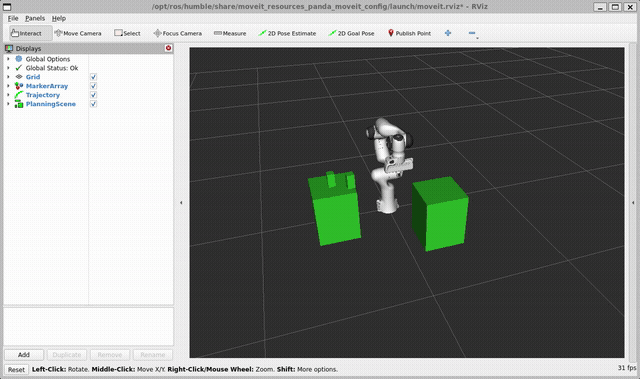

# Autonomous Robotic Pick-and-Place with MoveIt 2 & Franka Panda


An autonomous manipulation pipeline implemented in **ROS 2 Humble** and **MoveIt 2** using the 7-DOF **Franka Emika Panda** industrial arm and parallel-jaw gripper.

---

## Demonstration
<p align="center">
  
</p>

---

## Overview
This project simulates an automated industrial transfer cell. The robot operates within a collision-aware Planning Scene, identifying pick/place workbenches, calculating collision-free trajectories, executing physical grasping through attached collision interfaces, and completing transfer operations.

### Key Capabilities
* **Full 7-DOF Arm & Gripper Kinematic Control:** Synchronized trajectory generation across joint axes (`panda_joint1`–`panda_joint7`, `panda_finger_joint1`–`panda_finger_joint2`).
* **Dynamic Planning Scene Management:** Real-time generation of work platforms and workpiece entities via ROS 2 `/collision_object` interfaces.
* **Payload Attachment Pipeline:** Reliable workpiece attachment and detachment during pick-and-place execution using `moveit_msgs/AttachedCollisionObject`.
* **Repeatable Execution:** Operates on validated industrial kinematics and trajectory solvers without physics contact instabilities.

---

## System Requirements
* Ubuntu 22.04 LTS
* ROS 2 Humble Hawksbill
* MoveIt 2 (`ros-humble-moveit`)
* Python 3.10+

---

## Installation & Setup

```bash
# Clone into your colcon workspace
cd ~/ros2_ws/src
git clone [https://github.com/Henrietta22/Panda_pick_and_Place.git](https://github.com/Henrietta22/Panda_pick_and_Place.git)

# Build and source
cd ~/ros2_ws
colcon build --packages-select panda_pick_and_place --symlink-install
source install/setup.bash
